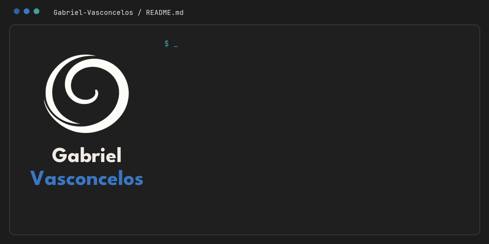

  

## About

I turn manual, spreadsheet-based operations into structured systems and decision-ready reporting.

For the past 2+ years I have worked at a media planning agency, replacing manual routines with automated workflows and building the reporting that account teams and clients use every day.

## What I've built

- **Internal media planning platform** (Python, NiceGUI, SQLite, Docker). Map-based planning, geospatial analysis, automated insertion orders, Excel exports, audit log and access levels by user profile. It handles 350,000+ media points and is used by about 10 people. Specified by me and built with AI assistance.
- **Power BI dashboards** for around 30 client projects, tracking reach, coverage, frequency, TRP and CPM.
- **Automated reporting workflows** that cut recurring tasks from 2-3 days to about 6 hours.

Client data is private, so a public demo of the planning platform with synthetic data is in progress.

## Toolbox

`Power BI` · `Excel` · `Python` · `SQLite` · `Docker`

## Currently studying

SQL, Power Query, DAX, business process modeling (BPMN) and n8n automation. Bachelor's degree in Economics in progress (expected December 2027).

## Contact

- LinkedIn: [gabriel-vasconcelos-br](https://www.linkedin.com/in/gabriel-vasconcelos-br)

Open to remote roles in business operations, automation and business analysis.
